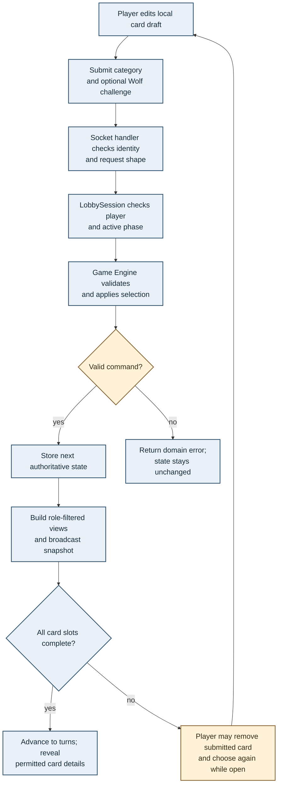

# Card Selection Flow

After team assignment, player views receive categories allowed for their team and their own slot state. Wolf views include challenge choices; Sheep views expose only challenge counts. The Host sees submitted categories and readiness, not challenge text. A slotless player is shown a waiting state.

The player edits a local draft in the card-selection UI. Submit and remove commands go through Socket.IO and are validated by the server and Game Engine. Submitted slots can be removed and replaced while selection remains active. The Game Engine advances to turns only when all card slots are complete; timer expiration does not auto-fill a slot. When the phase advances, authorized views expose the selected cards and challenge details.

The code contains this full server transition and UI selection flow. See [card-selection specification](../../../specs/05-features/card-selection/flow.md) for privacy and timer invariants.
