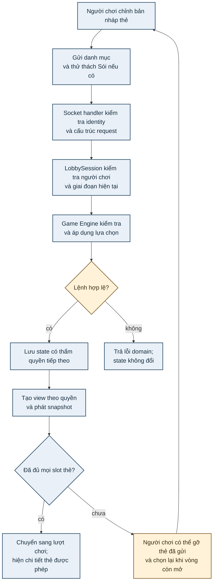

# Luồng chọn thẻ

Sau khi chia đội, view người chơi nhận danh mục được phép và trạng thái slot của chính họ. View Sói có lựa chọn thử thách; view Cừu chỉ có số lượng thử thách. Host thấy danh mục đã gửi và mức sẵn sàng, không thấy nội dung thử thách. Người không có slot được hiển thị trạng thái chờ.

Người chơi chỉnh bản nháp cục bộ trong giao diện chọn thẻ. Lệnh gửi và gỡ thẻ đi qua Socket.IO rồi được server và Game Engine kiểm tra. Có thể gỡ và thay slot đã gửi khi vòng chọn còn mở. Game Engine chỉ chuyển sang lượt chơi khi mọi slot đã hoàn tất; hết giờ không tự điền slot. Khi chuyển giai đoạn, view có quyền sẽ thấy thẻ đã chọn và nội dung thử thách.

Mã nguồn có cả chuyển trạng thái phía server và luồng giao diện chọn thẻ. Xem [đặc tả chọn thẻ](../../../specs/05-features/card-selection/flow.md) về quyền riêng tư và bất biến timer.
