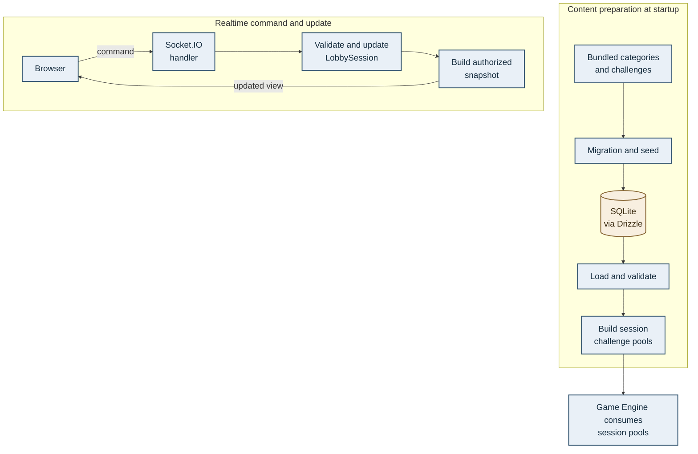

# Game Content and Realtime Update Flow

At startup, `openContentDatabase` opens `.data/noname.db`, applies Drizzle migrations, seeds bundled rows, and loads validated categories and challenges. Game setup derives session pools from this content. The database stores content, not active player/session/game state.

Socket.IO handlers bind each connection to a server-side identity. On join or resume they return a current view; on valid commands they update the session and publish new views. Each view is generated for its recipient, so a client does not receive information hidden in its current role or phase. Disconnection changes presence; reconnect can recover from the running Host session using the browser credential. Ending a room clears the credentials and active session.

This is one in-process Host; there is no separate database server or multi-node synchronization. See [static content](../../../specs/05-features/static-game-content/flow.md) and [realtime synchronization](../../../specs/05-features/realtime-synchronization/flow.md).
