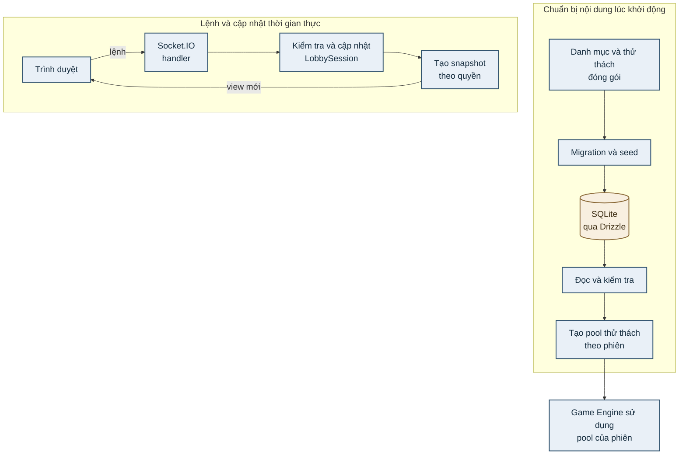

# Luồng nội dung game và cập nhật thời gian thực

Khi khởi động, `openContentDatabase` mở `.data/noname.db`, chạy Drizzle migration, seed dữ liệu đóng gói và tải danh mục/thử thách đã kiểm tra. Game setup tạo pool theo phiên từ nội dung này. Database lưu nội dung, không lưu người chơi, session hay state trận đang hoạt động.

Socket.IO handler gắn mỗi kết nối với identity phía server. Khi tham gia hoặc tiếp tục phiên, server trả view hiện tại; với command hợp lệ, server cập nhật session và phát view mới. Mỗi view được tạo cho người nhận nên client không nhận dữ liệu bị ẩn với vai trò hoặc giai đoạn hiện tại. Ngắt kết nối cập nhật presence; kết nối lại có thể khôi phục từ session Host còn chạy bằng credential trình duyệt. Kết thúc phòng sẽ xóa credential và session.

Đây là một Host chạy trong một tiến trình; không có database server riêng hay đồng bộ đa node. Xem [nội dung tĩnh](../../../specs/05-features/static-game-content/flow.md) và [đồng bộ thời gian thực](../../../specs/05-features/realtime-synchronization/flow.md).
