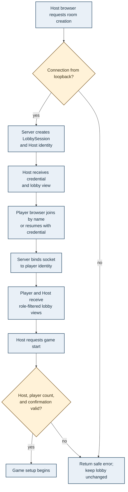

# Player Identity and Lobby Flow

This page follows the implemented flow from the home screen through lobby start. See the [authentication](../../../specs/05-features/authentication/flow.md) and [session management](../../../specs/05-features/session-management/flow.md) specifications for the full product contract.

1. The home page renders `LobbyScreen`, which uses lobby hooks to open Socket.IO and show connection, identity, and lobby state.
2. A local browser can request Host creation. The server accepts it only from a loopback connection, creates a `LobbySession`, then issues a Host identity and credential.
3. A player joins with a display name, or resumes using the credential presented at connection time. The server binds the socket to the resulting identity and returns a role-filtered view.
4. The lobby tracks connected and disconnected participants. A reconnect restores a participant while the in-memory session remains alive.
5. The Host starts the match. The server checks Host authority, player count and any low-population confirmation before game setup.

The credential is held by the browser in `localStorage`; it is not a player account. Live room data is in memory, so a Host restart ends the session. See [Realtime updates](content-and-realtime.md) for snapshot delivery.
