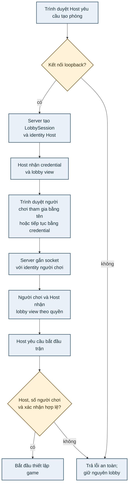

# Luồng identity người chơi và lobby

Trang này mô tả luồng đã triển khai từ trang chủ đến khi bắt đầu lobby. Xem đặc tả [authentication](../../../specs/05-features/authentication/flow.md) và [quản lý session](../../../specs/05-features/session-management/flow.md) để biết hợp đồng sản phẩm đầy đủ.

1. Trang chủ render `LobbyScreen`; các lobby hook mở Socket.IO và hiển thị kết nối, identity cùng trạng thái phòng.
2. Trình duyệt tại máy Host có thể yêu cầu tạo phòng. Server chỉ chấp nhận kết nối loopback, tạo `LobbySession`, rồi cấp identity và credential Host.
3. Người chơi tham gia bằng tên hiển thị hoặc tiếp tục phiên bằng credential gửi lúc kết nối. Server gắn socket với identity tương ứng và trả về view theo quyền.
4. Lobby theo dõi người đang kết nối và đã ngắt kết nối. Kết nối lại khôi phục người chơi khi session trong bộ nhớ còn tồn tại.
5. Host bắt đầu trận. Server kiểm tra quyền Host, số người chơi và xác nhận số lượng thấp nếu cần trước khi thiết lập game.

Credential được trình duyệt lưu trong `localStorage`; đây không phải tài khoản người chơi. Dữ liệu phòng đang chạy nằm trong bộ nhớ nên khởi động lại Host sẽ kết thúc session. Xem [Đồng bộ thời gian thực](content-and-realtime.vi.md) về cách gửi snapshot.
