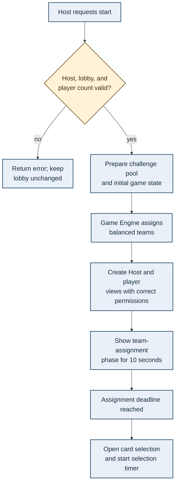

# Team Assignment Flow

`LobbySession.start` validates Host identity, connected joining-player count, and low-population confirmation. `prepareGameSetup` prepares session challenge pools and calls the Game Engine start command, which uses the team-assignment operation. The Host remains an observer; joining players receive teams and card-slot eligibility.

The server holds the assignment phase for ten seconds using an in-memory deadline. The browser renders the current phase and countdown. On completion, the session initializes the card-selection timing window and the view advances to selection. Any setup failure returns an error without publishing a partially assigned match.

The product contract specifies richer roster animation and reconnect timing behavior. Check current view and screen code before relying on those details; the authoritative transition and ten-second deadline are server-side. See [team-assignment specification](../../../specs/05-features/team-assignment/flow.md).
