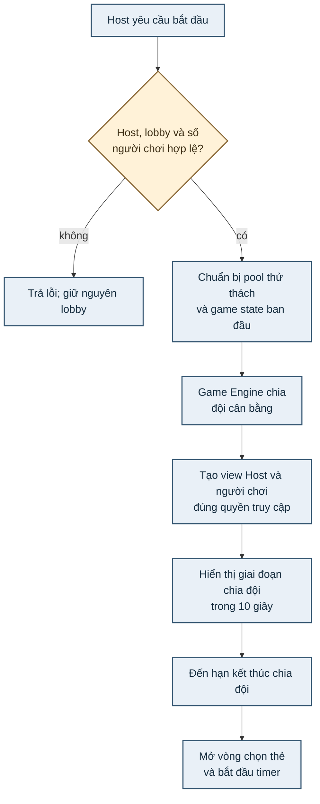

# Luồng chia đội

`LobbySession.start` kiểm tra identity Host, số người chơi đang kết nối và xác nhận số lượng thấp. `prepareGameSetup` chuẩn bị pool thử thách của phiên rồi gọi lệnh bắt đầu trong Game Engine, dùng thao tác chia đội. Host chỉ quan sát; người chơi tham gia nhận đội và trạng thái có slot thẻ hay không.

Server giữ giai đoạn chia đội trong mười giây bằng deadline trong bộ nhớ. Trình duyệt render giai đoạn và countdown hiện tại. Khi hết hạn, session thiết lập thời gian chọn thẻ và view chuyển sang chọn thẻ. Nếu setup lỗi, server trả lỗi mà không công bố trận đã chia đội dở dang.

Hợp đồng sản phẩm quy định thêm hiệu ứng roster và cách khôi phục thời gian khi kết nối lại. Hãy kiểm tra view và screen hiện có trước khi dựa vào các chi tiết đó; chuyển trạng thái chính và deadline mười giây do server quản lý. Xem [đặc tả chia đội](../../../specs/05-features/team-assignment/flow.md).
