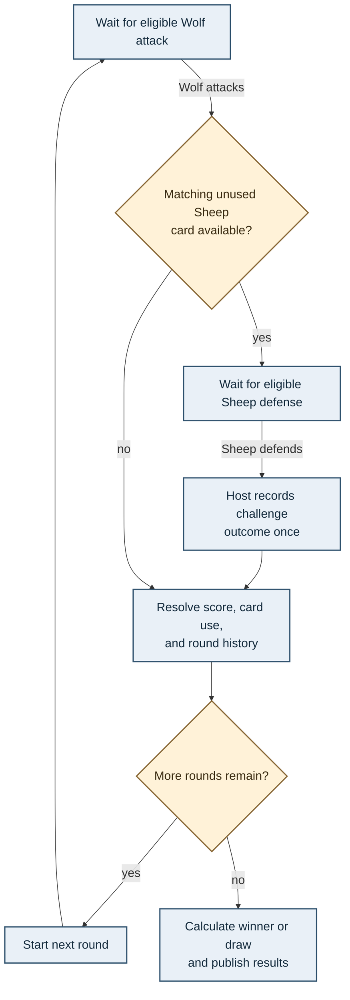

# Turns and Results Flow

The Game Engine accepts turn commands only in the turns phase. An attack must match the active round and come from a Wolf with an unused submitted card. The engine chooses an unused challenge from the category pool where possible. A Sheep player can defend only with an unused submitted card in the same category. If no eligible defense exists, the round resolves as an undefended attack. Otherwise the Host records the challenge outcome once.

The engine records card use, score changes, round history, and the next round. An undefended attack gives Wolf two points; a defended challenge gives Sheep one point, plus one more when successful. After the last round it sets the results phase and winner or draw. Server views carry the active turn, team-appropriate data, scores, history, and result. `LobbyScreen` selects the player/Host turn screens and the end-game screen from those views.

Turn commands and screens exist in source. Verify the current client interactions against the [turn gameplay](../../../specs/05-features/turn-gameplay/flow.md) and [scoring/results](../../../specs/05-features/scoring-results/flow.md) contracts before changing them.
