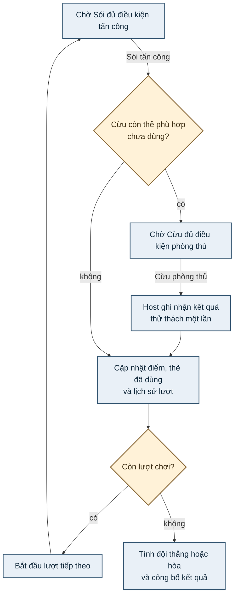

# Luồng lượt chơi và kết quả

Game Engine chỉ nhận lệnh lượt trong giai đoạn turns. Lệnh tấn công phải đúng round hiện tại và đến từ Sói có thẻ đã gửi nhưng chưa dùng. Engine ưu tiên chọn thử thách chưa dùng trong pool danh mục. Người Cừu chỉ có thể phòng thủ bằng thẻ đã gửi, chưa dùng và cùng danh mục. Nếu không còn Cừu đủ điều kiện thì lượt được giải quyết như một đòn không bị phòng thủ. Nếu có phòng thủ, Host ghi kết quả thử thách đúng một lần.

Engine ghi nhận thẻ đã dùng, thay đổi điểm, lịch sử lượt và round tiếp theo. Đòn không phòng thủ cho Sói hai điểm; phòng thủ cho Cừu một điểm, cộng thêm một nếu thử thách thành công. Sau lượt cuối, engine chuyển sang kết quả và xác định đội thắng hoặc hòa. Server view chứa lượt đang diễn ra, dữ liệu theo đội, điểm, lịch sử và kết quả. `LobbyScreen` chọn màn hình lượt của người chơi/Host và màn hình kết thúc dựa trên view.

Mã nguồn có command và screen cho lượt chơi. Khi thay đổi, hãy đối chiếu tương tác client với hợp đồng [gameplay lượt](../../../specs/05-features/turn-gameplay/flow.md) và [điểm/kết quả](../../../specs/05-features/scoring-results/flow.md).
