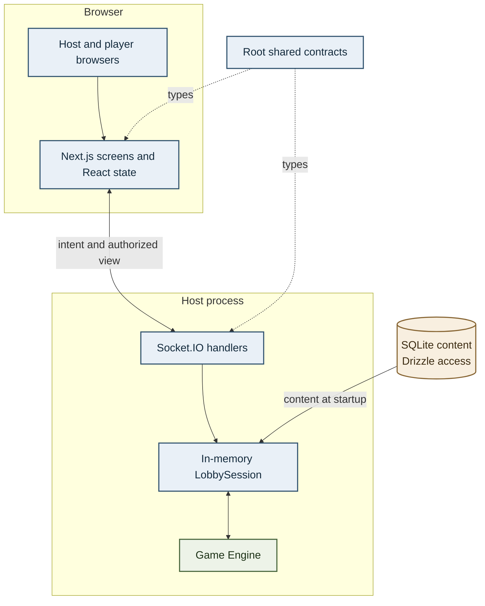

# Project Architecture and Structure

This guide describes the architecture present in the repository today. The product and technical specifications define the intended V0 contract; where a feature is specified but its full user interface is not yet wired, that distinction is called out.

## Runtime at a glance

The repository is one TypeScript application. `backend/server.ts` starts the Host process: it opens the local content database, prepares Next.js from `web-game/`, creates one HTTP server, attaches Socket.IO, and registers the lobby transport. The Host listens on `0.0.0.0` by default and prints its loopback and detected private IPv4 addresses. Browsers connect to this same Host over HTTP and Socket.IO.

The diagram shows code responsibilities, not separate deployed services. The browser does not connect to SQLite or make authoritative game decisions.

## What is implemented

| Area | Current implementation |
| --- | --- |
| Browser application | Next.js App Router under `web-game/app/`; React screens and feature-specific hooks/components under `web-game/features/`; shared visual components under `web-game/components/`. |
| Client/server contract | Serializable lobby and card-selection views and event names in root `shared/`. |
| Realtime transport | One Socket.IO server attached to the HTTP server; lobby, Host, card, and turn handlers under `backend/`. |
| Session/application behavior | `backend/lobby-session.ts` and focused session modules maintain the active room, players, timers, and game state in process memory. Handler modules authenticate socket identity and delegate operations. |
| Game rules | Pure TypeScript state and commands under `web-game/game/`; team assignment, card-selection transitions, turn resolution, scoring, and results are kept independent of React and Socket.IO. Backend setup calls this engine. |
| Persistent data | `backend/db/` uses Drizzle with `@libsql/client` and SQLite. It migrates, seeds, validates, and loads category/challenge content. The active lobby and match are not persisted. |
| Verification | Vitest tests cover engine, sessions, transport, views, and content; Playwright covers browser flows. |

The package has Zustand as a dependency, but the current source contains no Zustand store: the active UI receives server snapshots through React state in feature hooks. Do not describe Zustand as current state infrastructure until a store is added and used.

## Request and state flow

1. A browser creates a Socket.IO connection. The client lobby hook stores the returned credential in `localStorage`; reconnect presents it to the Host.
2. A player sends an intent through a shared event contract. The transport binds each socket to a server-created Host or player identity; event payloads do not grant authority themselves.
3. A handler checks the request, identity, and relevant session/phase constraints, then calls a `LobbySession` operation.
4. The session delegates game-changing commands to the Game Engine. Accepted commands replace authoritative state; rejected commands return a stable error and leave state unchanged.
5. The backend builds a viewer-specific lobby/game snapshot and emits it over Socket.IO. Views filter information by role and phase, including unrevealed Wolf choices.
6. Feature hooks update React state from the received snapshot. Client drafts are local conveniences; the Host remains the source of truth.

## Main boundaries

- `web-game/app/` owns route entry and page composition. The home route renders the lobby screen; team and game phases are selected from the current server view.
- `web-game/features/` owns browser workflows. `lobby/` coordinates connection, identity, lobby actions, and phase rendering; `game/` renders card selection and turn views; `results/` renders the end-game view.
- `web-game/game/` owns domain types, commands, validation, randomness abstraction, and transitions. It must not depend on browser, transport, or persistence code.
- `backend/` owns Host runtime, Socket.IO handlers, the in-memory session, view shaping, and orchestration around engine commands.
- `backend/db/` owns schema, migrations, content validation, seed, and repository access. Database code does not implement game rules.
- Root `shared/` holds contracts shared by browser and backend. Keep feature-specific behavior in its feature or domain module.

## Persistence and runtime limits

SQLite stores static categories and challenges under `.data/noname.db`. Startup migrates the database, seeds bundled content, validates relationships/content, and loads it for session setup. A per-session challenge pool is then prepared for gameplay. Live identities, credentials, lobby presence, timers, and game state live in memory, so a Host process restart ends the recoverable session. A browser refresh can resume only while that Host process and session are still running.

The checked-in source includes server and engine operations for attacks, defenses, challenge outcomes, scores, and results, plus corresponding phase views/screens. Product specifications describe broader requirements; consult each feature page for implementation boundaries and any difference between a contract and the visible UI.

## Feature workflow guides

- [Player identity and lobby](features/player-identity-and-lobby.md) ([Tiếng Việt](features/player-identity-and-lobby.vi.md))
- [Team assignment](features/team-assignment.md) ([Tiếng Việt](features/team-assignment.vi.md))
- [Card selection](features/card-selection.md) ([Tiếng Việt](features/card-selection.vi.md))
- [Turns and results](features/turns-and-results.md) ([Tiếng Việt](features/turns-and-results.vi.md))
- [Game content and realtime updates](features/content-and-realtime.md) ([Tiếng Việt](features/content-and-realtime.vi.md))

## Authoritative references

The specifications remain the product and technical contract: [architecture](../../specs/03-technical/architecture.md), [project structure](../../specs/03-technical/project-structure.md), [backend architecture](../../specs/04-backend/architecture.md), [database](../../specs/04-backend/database.md), and [feature overview](../../specs/05-features/features-overview.md).
