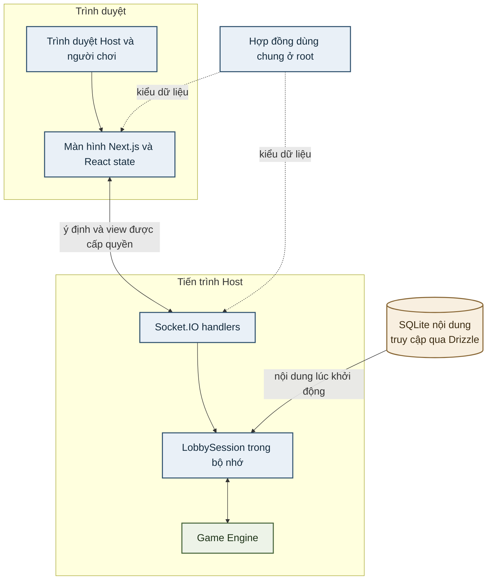

# Kiến trúc và cấu trúc dự án

Tài liệu này mô tả kiến trúc đang có trong mã nguồn. Đặc tả sản phẩm và kỹ thuật vẫn là hợp đồng V0; nếu một tính năng đã được đặc tả nhưng giao diện chưa nối đầy đủ, tài liệu sẽ phân biệt rõ.

## Tổng quan khi chạy

Đây là một ứng dụng TypeScript. `backend/server.ts` khởi chạy tiến trình Host: mở cơ sở dữ liệu nội dung cục bộ, chuẩn bị Next.js từ `web-game/`, tạo một HTTP server, gắn Socket.IO và đăng ký lobby transport. Mặc định Host lắng nghe trên `0.0.0.0` và in địa chỉ loopback cùng IPv4 riêng tìm được. Trình duyệt kết nối tới cùng Host bằng HTTP và Socket.IO.

Sơ đồ thể hiện trách nhiệm của mã nguồn, không phải các dịch vụ được triển khai tách biệt. Trình duyệt không kết nối SQLite và không tự quyết định trạng thái game có thẩm quyền.

## Những gì đã được triển khai

| Khu vực | Hiện trạng |
| --- | --- |
| Ứng dụng trình duyệt | Next.js App Router trong `web-game/app/`; màn hình React, hook và component theo tính năng trong `web-game/features/`; component giao diện dùng chung trong `web-game/components/`. |
| Hợp đồng client/server | Kiểu snapshot lobby và chọn thẻ, cùng tên sự kiện trong `shared/` ở root. |
| Truyền thông thời gian thực | Một Socket.IO server gắn với HTTP server; handler lobby, Host, thẻ và lượt chơi trong `backend/`. |
| Phiên và điều phối ứng dụng | `backend/lobby-session.ts` cùng các module phiên chuyên biệt giữ phòng đang chạy, người chơi, bộ đếm thời gian và trạng thái trận trong bộ nhớ tiến trình. Handler xác thực identity của socket rồi ủy quyền thao tác. |
| Luật game | State và command TypeScript thuần trong `game-engine/`; chia đội, chuyển trạng thái chọn thẻ, xử lý lượt, tính điểm và kết quả không phụ thuộc React hay Socket.IO. Backend gọi engine để thiết lập trận. |
| Dữ liệu lưu trữ | `backend/db/` dùng Drizzle với `@libsql/client` và SQLite để migrate, seed, kiểm tra và đọc nội dung danh mục/thử thách. Lobby và trận đang hoạt động không được lưu xuống DB. |
| Kiểm chứng | Vitest kiểm tra engine, phiên, transport, view và nội dung; Playwright kiểm tra luồng trình duyệt. |

Package có Zustand nhưng mã nguồn hiện chưa có store Zustand nào được sử dụng. UI nhận snapshot máy chủ qua React state trong các feature hook. Không nên mô tả Zustand là hạ tầng state hiện tại cho đến khi store được tạo và sử dụng.

## Luồng lệnh và trạng thái

1. Trình duyệt tạo kết nối Socket.IO. Hook lobby lưu credential được cấp vào `localStorage`; khi kết nối lại, trình duyệt gửi credential đó cho Host.
2. Người chơi gửi ý định qua event contract dùng chung. Transport gắn socket với identity Host hoặc người chơi do máy chủ tạo; payload không thể tự cấp quyền.
3. Handler kiểm tra request, identity và điều kiện phiên/giai đoạn liên quan, rồi gọi thao tác trên `LobbySession`.
4. Session chuyển lệnh làm thay đổi game tới Game Engine. Lệnh hợp lệ thay thế trạng thái có thẩm quyền; lệnh bị từ chối trả lỗi ổn định và không sửa trạng thái.
5. Backend tạo snapshot lobby/game theo quyền người xem rồi phát qua Socket.IO. View lọc thông tin theo vai trò và giai đoạn, bao gồm lựa chọn Sói chưa được lật.
6. Feature hook cập nhật React state từ snapshot nhận được. Bản nháp phía client chỉ để thao tác thuận tiện; Host vẫn là nguồn sự thật.

## Ranh giới chính

- `web-game/app/` phụ trách điểm vào route và ghép trang. Trang chủ hiển thị lobby; các giai đoạn đội, game được chọn theo view từ máy chủ.
- `web-game/features/` phụ trách luồng trình duyệt. `lobby/` điều phối kết nối, identity, thao tác phòng và chọn màn hình; `game/` hiển thị chọn thẻ và lượt; `results/` hiển thị kết quả cuối.
- `game-engine/` chứa kiểu domain, command, kiểm tra luật, trừu tượng ngẫu nhiên và chuyển trạng thái. Không phụ thuộc browser, transport hay persistence.
- `backend/` phụ trách Host runtime, Socket.IO handler, session trong bộ nhớ, tạo view và điều phối gọi engine.
- `backend/db/` phụ trách schema, migration, kiểm tra nội dung, seed và truy cập repository. Mã DB không chứa luật game.
- `shared/` ở root chứa hợp đồng dùng chung giữa browser và backend. Logic riêng của tính năng nằm trong feature hoặc domain tương ứng.

## Lưu trữ và giới hạn runtime

SQLite lưu danh mục và thử thách tĩnh tại `.data/noname.db`. Khi khởi động, ứng dụng migrate, seed nội dung đóng gói, kiểm tra dữ liệu rồi tải vào bộ nhớ để thiết lập phiên. Sau đó game tạo pool thử thách riêng cho trận. Identity, credential, hiện diện lobby, timer và trạng thái trận nằm trong bộ nhớ; vì vậy khởi động lại Host làm mất phiên đang chạy. Refresh trình duyệt chỉ khôi phục được khi tiến trình Host và session vẫn hoạt động.

Mã nguồn hiện có thao tác server và engine cho tấn công, phòng thủ, ghi kết quả thử thách, tính điểm và kết quả cuối, cùng view/màn hình cho các giai đoạn tương ứng. Đặc tả sản phẩm có thể mô tả phạm vi rộng hơn; xem từng trang luồng để biết ranh giới triển khai và khác biệt với giao diện hiện có.

## Tài liệu luồng tính năng

- [Identity người chơi và lobby](features/player-identity-and-lobby.vi.md)
- [Chia đội](features/team-assignment.vi.md)
- [Chọn thẻ](features/card-selection.vi.md)
- [Lượt chơi và kết quả](features/turns-and-results.vi.md)
- [Nội dung game và đồng bộ thời gian thực](features/content-and-realtime.vi.md)

## Tài liệu đặc tả gốc

Đặc tả là hợp đồng sản phẩm và kỹ thuật: [kiến trúc](../../specs/03-technical/architecture.md), [cấu trúc dự án](../../specs/03-technical/project-structure.md), [kiến trúc backend](../../specs/04-backend/architecture.md), [cơ sở dữ liệu](../../specs/04-backend/database.md), [tổng quan tính năng](../../specs/05-features/features-overview.md).
